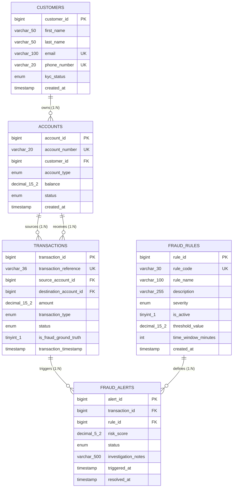

# FraudLens: Entity-Relationship (ER) Diagram

This diagram represents the physical relational schema implemented in [database/schema.sql](file:///Users/siddharthlal/Desktop/fraudlens/database/schema.sql).

---

## Mermaid Entity-Relationship Diagram

---

## Cardinalities and Referential Integrity

1. **`CUSTOMERS` to `ACCOUNTS` (1:N)**:
   - One customer can hold zero or more accounts.
   - Each account belongs to exactly one customer (`customer_id NOT NULL`).
   - Action: `ON UPDATE RESTRICT ON DELETE RESTRICT`.

2. **`ACCOUNTS` to `TRANSACTIONS` (1:N)**:
   - An account can be the source of zero or more transactions (`source_account_id`).
   - An account can be the destination of zero or more transactions (`destination_account_id`).
   - Constraint: `CHECK (source_account_id <> destination_account_id)`.
   - Action: `ON UPDATE RESTRICT ON DELETE RESTRICT`.

3. **`TRANSACTIONS` to `FRAUD_ALERTS` (1:N)**:
   - A transaction may trigger zero or multiple fraud alerts if it violates multiple distinct detection rules.
   - Each alert is tied to exactly one transaction.
   - Action: `ON UPDATE RESTRICT ON DELETE RESTRICT`.

4. **`FRAUD_RULES` to `FRAUD_ALERTS` (1:N)**:
   - A rule can trigger multiple alerts across transactions over time.
   - Each alert identifies the specific rule that generated it.
   - Action: `ON UPDATE RESTRICT ON DELETE RESTRICT`.
